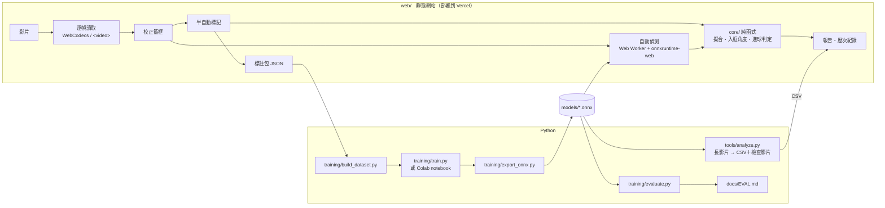

# ArcLog 練投紀錄員

手機用腳架固定在球場側面錄練投，ArcLog 算出**每一球的入框角度**和**進球與否**，產出一份練習報告。

這是政大「計算思維與人工智慧應用導論」的小組專題，使用對象是籃球隊的球員。
做法參考市面上的投籃分析系統常用的指標：入框角度以 45 度為參考值。
單支手機側拍只量得準入框角度，所以這個工具**不量**投籃的深度和左右偏差。

- **影片只在你的手機或電腦上處理，不會上傳到任何地方。** 網站是純靜態網頁，沒有後端。
- 沒有影片也可以先試：首頁的「示範模式」會用物理模擬畫出 10 球，每球有已知的真實角度。
- 目前**還沒有用實拍影片驗證過準確度**。哪些驗證過、哪些沒有，寫在 [`docs/EVAL.md`](docs/EVAL.md)。

## 它做什麼

1. **載入影片**：手機拍的 MP4／MOV。逐幀定位以影片檔裡的時間戳為準（可變幀率也沒問題）。
2. **校正**：在畫面上點籃框的前緣和後緣。籃框內徑 45 公分用來換算比例。
   水平方向預設由兩點連線扣掉透視造成的傾斜得到（假設用手機 1 倍鏡頭拍）；
   也可以改成多點一條鉛直的邊（例如籃板側邊）當基準，這樣不需要焦距假設（怎麼選見[拍攝指南](docs/SHOOTING_GUIDE.md)）。
3. **半自動標記**：每一球點 4 到 6 個球心，程式擬合出軌跡並疊在畫面上讓你確認。
   入框角度＝球下降通過籃框平面那一點，軌跡的切線和水平的夾角。
4. **自動偵測**：在瀏覽器裡用 ONNX 模型逐幀找球（WebGPU 優先，不支援時用 WASM），把偵測點串成軌跡，
   每一球給一張確認卡，可以接受、修正或刪除。模型載入失敗或找不到球時，退回半自動。
5. **報告**：出手數、命中率、入框角度的平均和標準差、每球角度的散點圖、前半和後半的比較、幾句白話摘要。
   可以匯出 CSV 和報告圖片。
6. **歷次紀錄**：存在瀏覽器本機，可以看趨勢、匯出匯入備份。
7. **匯出標註包**：把標記結果匯出成 JSON，之後用來訓練更準的偵測模型。

## 架構



| 資料夾 | 內容 |
|---|---|
| `web/` | 靜態網站：純 HTML、CSS、原生 JavaScript（ES modules），沒有 build 步驟、不使用 CDN。Vercel 的根目錄設在這裡 |
| `web/js/core/` | 不碰 DOM 的純函式：籃框座標、拋物線擬合、入框角度、進球判定、軌跡追蹤、統計、CSV、標註包 |
| `web/vendor/` | 第三方檔案（onnxruntime-web、Mediabunny），下載後一起提交，來源和雜湊值見 [`web/vendor/README.md`](web/vendor/README.md) |
| `arclog/` | Python 程式庫，和 `web/js/core/` 一一對應（同樣的算法、同樣的運算順序） |
| `tools/` | 指令工具：`analyze.py`（分析長影片）、`serve.py`（本機預覽）、`check_staged.py`（提交前檢查）、`camera_study.mjs`（鏡頭擺位模擬） |
| `training/` | 資料轉換、訓練、評估、匯出模型的腳本，和一份 Colab notebook |
| `models/` | 匯出的 ONNX 模型、模型清單、[模型卡](models/MODEL_CARD.md)。`tools/sync_models.py` 會複製一份到 `web/models/` |
| `tests/` | 測試。`tests/vectors/` 是 JavaScript 和 Python **共用**的測試向量，確保兩邊算出來的角度一致 |
| `docs/` | [實作計畫](docs/PLAN.md)、[拍攝指南](docs/SHOOTING_GUIDE.md)、[資料與隱私](docs/DATA.md)、[評估結果](docs/EVAL.md)、[接下來要做的事](docs/NEXT_STEPS.md) |

## 在電腦上預覽

需要 Python 3.10 以上。指令都是 Windows PowerShell 用的，一行一個。

```powershell
python tools/serve.py
```

用 Chrome 打開 http://127.0.0.1:8000 ，按「示範模式（不用影片）」。

不要直接點兩下打開 `web/index.html`：瀏覽器不允許從檔案路徑載入程式模組和模型。
`tools/serve.py` 也會送出讓多執行緒運算可以啟用的標頭（和部署到 Vercel 時相同）。

## 部署到 Vercel

1. 到 https://vercel.com 用 GitHub 帳號登入，**Add New… → Project**，匯入這個 repo。
2. **Root Directory** 按 Edit，選 **`web`**。
3. **Framework Preset** 選 **Other**；Build Command、Output Directory 都留空。
4. 按 **Deploy**。

之後 push 到 `main` 會自動重新部署。自訂網域之後在 Vercel 的 Settings → Domains 綁定即可，repo 裡不需要 `CNAME` 檔。
更詳細的步驟（含手機實測清單）在 [`docs/NEXT_STEPS.md`](docs/NEXT_STEPS.md)。

## 用指令工具分析長影片

十分鐘以上的影片建議在筆電上用指令工具處理。它用同一個模型、同一套軌跡邏輯，輸出和網站相同格式的 CSV，以及一支疊了軌跡的檢查影片。

```powershell
python -m pip install -r requirements.txt
```

```powershell
python tools/analyze.py "D:\影片\練投.mov" --hoop 1403.5,412.0,1538.2,410.6
```

`--hoop` 是籃框前緣和後緣的像素座標。在網站上載入同一支影片並完成校正後，報告頁最下面會直接給你整行指令
（校正時選了「垂直參考線」的話，指令會多一段 `--level vertical --vertical x1,y1,x2,y2`）。
輸出的 CSV 可以用網站首頁的「匯入 CSV」看報告。

## 訓練偵測模型

模型只學一件事：在畫面裡找出籃球。分三個階段，每個階段產出一個可以互相比較的模型：

| 階段 | 資料 | 狀態 |
|---|---|---|
| **A** 預訓練基準 | 直接用 COCO 預訓練權重的 sports ball 類別 | 已完成，網站預設使用 |
| **B** 公開資料訓練 | Roboflow Universe 上 CC BY 4.0 授權的籃球資料集 | 腳本和 notebook 已寫好，還沒有實際訓練；需要 Roboflow 金鑰才能下載資料 |
| **C** 自有資料微調 | 自己拍的影片＋網站匯出的標註包 | 腳本和 notebook 已寫好，還沒有實際訓練；需要實拍影片 |

```
影片＋標註包 ──build_dataset.py──▶ 訓練資料（以影片為單位切成訓練／驗證／測試）
                                      │
              check_overlay.py ◀──────┤  隨機抽樣把框疊在畫面上，用眼睛確認沒有錯位
                                      ▼
                                  train.py ──▶ best.pt ──export_onnx.py──▶ models/*.onnx ──▶ 網站、analyze.py
                                                                                │
            同一批測試影片 ──────────────────────────────── evaluate.py ◀──────┘──▶ docs/EVAL.md
```

- **在 Colab 上訓練**（建議；這個專案開發用的電腦沒有 NVIDIA 顯示卡）：
  [`training/arclog_train.ipynb`](training/arclog_train.ipynb) 從安裝套件到下載結果一次跑完，每一格前面都有中文說明。
- **在自己的電腦上訓練**（有 NVIDIA 顯示卡時）：

  ```powershell
  python -m pip install -r training/requirements.txt
  ```

  ```powershell
  python training/train.py --stage B --data datasets/public_ball/data.yaml
  ```

- 評估以**影片**為單位切分資料，同一支影片的畫面不會同時出現在訓練和測試。
  量的是飛行中的球的 recall／precision，以及自動流程算出的入框角度和人工標記的差距。結果寫進 [`docs/EVAL.md`](docs/EVAL.md)。

沒有實拍影片時，可以用合成畫面把整條流程跑一次（[`docs/EVAL.md`](docs/EVAL.md) 第 2 節）。那只能證明流程沒壞，**不代表真實準確度**。
這條路已經在開發用的電腦（只有 CPU）上跑完一次：合成影片 → 資料集 → 訓練 1 輪 → 匯出 → 評估 → 網站載入新模型並偵測到球。

## 測試

```powershell
npm install
```

```powershell
python -m pip install -r requirements.txt -r requirements-dev.txt
```

| 指令 | 內容 |
|---|---|
| `npm test` | JavaScript 單元測試：純函式、共用測試向量、鏡頭擺位模擬 |
| `python -m pytest` | Python 測試：同一份測試向量（和 JavaScript 的結果比對到小數第六位）、影片讀取、模型、資料集工具 |
| `npm run test:e2e` | 用真的 Chrome 開網站跑完整流程（需要電腦裝有 Chrome；約 8 分鐘。合成資料的模型還沒訓練出來時，`pipeline.e2e.mjs` 的 2 項會自動跳過） |
| `node tests/gen_vectors.mjs --check` | 確認測試向量和目前的程式一致 |
| `python tools/check_staged.py` | 提交前檢查暫存區沒有影片、人像、權重、金鑰 |

## 資料與隱私

這是公開的 repo。**實拍影片、抽出的畫面、任何含人像的檔案都不可以提交**；只提交程式、文件、合成素材和模型。
影片請放在 repo 以外，拍攝和使用前要取得球員和教練的同意。細節在 [`docs/DATA.md`](docs/DATA.md)。

## 授權

本專案以 **GNU AGPL-3.0** 釋出（[`LICENSE`](LICENSE)），因為偵測模型使用 Ultralytics YOLO。

| 項目 | 授權 | 備註 |
|---|---|---|
| 本專案的程式和文件 | AGPL-3.0 | |
| Ultralytics YOLO26n 模型與預訓練權重 | AGPL-3.0 | `models/` 裡的 ONNX 由它匯出或接著訓練 |
| COCO 資料集（階段 A 的訓練資料） | 標註 CC BY 4.0；影像各有授權 | cocodataset.org |
| Basketball Detection v6（Hooper，Roboflow Universe） | CC BY 4.0 | 階段 B 用；只用 ball 類別。尚未訓練 |
| shot（XINGHANs Workspace，Roboflow Universe） | CC BY 4.0 | 階段 B 用；只用 ball 類別。尚未訓練 |
| onnxruntime-web 1.31.1 | MIT | `web/vendor/ort-1.31.1/` |
| Mediabunny 1.65.2 | MPL-2.0 | `web/vendor/mediabunny-1.65.2/`，未修改 |

資料集的網址、版本和標示出處的文字在 [`docs/DATA.md`](docs/DATA.md) 第 4 節。

## 限制

- **實拍準確度未知。** 所有的角度誤差數字都來自合成畫面或幾何模擬。
- **手機擺位會造成系統性的偏差**：鏡頭往上仰、沒有對準正側面時，角度會差 0.5 到 3 度，而且程式修不掉。請照[拍攝指南](docs/SHOOTING_GUIDE.md)架設。
- **進球判定只是建議**：側拍看不到左右偏差，涮框、擦板只能猜，所以每一球都可以一鍵改正。
- **iPhone／Safari 沒有實機測過**（開發環境是 Windows 上的 Chrome）。
- 階段 A 的模型不是為了遠距離的小球訓練的，在實拍影片上可能漏球；這時請用半自動標記。

## 參考資料

設計時查證過的文件（瀏覽器的逐幀定位行為、模型匯出參數等）：

- Ultralytics 文件：YOLO26 模型、訓練參數、ONNX 匯出參數 — https://docs.ultralytics.com/
- onnxruntime-web：WebGPU 與 WASM 後端、多執行緒需要的跨來源隔離 — https://onnxruntime.ai/docs/tutorials/web/
- Mediabunny 指南：讀取影片、封包時間戳、解碼 — https://mediabunny.dev/guide/introduction
- `requestVideoFrameCallback()`：web.dev 的介紹 https://web.dev/articles/requestvideoframecallback-rvfc 、規格 https://wicg.github.io/video-rvfc/
- HTML 規格的 seeking 行為 — https://html.spec.whatwg.org/multipage/media.html#seeking
- 瀏覽器支援情況：https://caniuse.com/mdn-api_htmlvideoelement_requestvideoframecallback 、https://caniuse.com/webcodecs
- Chrome 的 HEVC 解碼支援 — https://chromestatus.com/feature/5186511939567616
- WebKit 部落格：Safari 16.4、17.4 的 WebCodecs 支援 — https://webkit.org/blog/
- Apple 文件：自動調整錄影幀率（`isAutoVideoFrameRateEnabled`）— https://developer.apple.com/documentation/avfoundation/
- Roboflow Universe 的資料集頁面（網址見 `docs/DATA.md`）

查證的結論和依此做的設計決定寫在 [`docs/PLAN.md`](docs/PLAN.md) 第 2 節。
